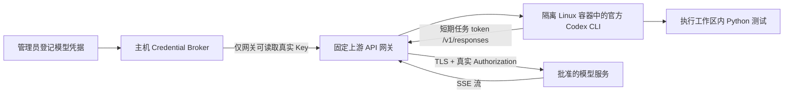

# Case 07：官方 Codex CLI 修复金额计算，API Key 在主机网关注入

状态：测试素材和配置模板已准备，初始失败基线可独立复现；
Linux 执行器与模型网关待实现，真实 Codex 执行、模型调用和 Key 注入未验证。

## 要验证的行为

管理员给一次任务授予模型调用能力。官方 Codex CLI 读取一个有 bug 的
Python 小项目，重现失败，修复实现，再运行 18 个验收测试。Codex 进程和
它启动的测试进程都不持有上游 API Key；主机网关转发模型请求时才加入
`Authorization: Bearer <真实 Key>`。

业务任务不需要 GPU、依赖安装、GitHub 访问或外部数据，只会调用模型服务。
初始限制建议为 2 vCPU、2 GiB 内存、300 秒总超时、最多 20 次模型请求、
工作区 100 MiB。请求数量与超时
不能替代提供商侧的实际消费限额；按所选模型设置项目预算及告警。

## 已确认的接入缺口

1. 当前 `apps/safedesk-images/agent-python/agentroot/codex` 是运行
   `run_ci.py` 的演示脚本，并非官方 Codex CLI。
2. 当前启动器只支持 Wasmer/WASIX。官方原生 Linux CLI 不能直接作为该
   Wasm 镜像的二进制运行。本 case 设计为新增 Linux 容器执行适配器，
   固定官方 CLI 版本及镜像 digest；容器方案尚未安装或实现。
3. 当前 egress 代理的 HTTPS CONNECT 是透明隧道，无法给隧道内请求补签。
   需要新增固定上游的 Responses API 网关；不能只设置 HTTPS_PROXY。
4. 运行前需配置 HTTPS Base URL、模型 ID 和凭据，并从网关验证上游可达。
   兼容服务必须支持 Responses 的增量 SSE、多轮工具调用及结果回传；
   `/models` 返回 200 或一次文本应答都不能证明 Codex 工具循环兼容。

## 凭据和网络设计



- Key：通过现有测试控制台的“凭据”登记，例如名称 `codex-case-api`。
  `allowedHosts` 填实际模型服务域名。不要将 Key 写入聊天、项目、镜像、
  提示词、Codex 配置或 CLI 参数。当前 Broker 使用 0600 明文文件，
  不能将它描述为已加密或已接 KMS。
- 隔离：Agent 容器只挂载本次任务工作区，使用非 root 用户；不挂载
  控制面 data、主机家目录、Docker socket 或宿主凭据文件。
- 网络：Agent 只接入无外网路由的内部网络；网关单独具备外联能力。
  网关既不提供 CONNECT，也不接受客户端传入目的 URL。
- 网关：用任务 token 验证本次会话、审批状态、到期时间及模型授权；
  每次读取 Broker 最新值，校验凭据绑定的精确主机。只允许
  `POST /v1/responses`、指定模型和有界请求体，按需另行审核其他端点。
  固定 HTTPS 上游并验证证书，不跟随重定向；丢弃客户端 Authorization，
  在主机侧重新构建。支持有界、可取消的 SSE 流，不缓存整个模型响应。
- 生命周期：pause/terminate 时拒绝新请求并关闭正在进行的响应流，
  撤销任务 token，停止容器；通过实际探测确认，不能只写 UI 状态。
- 日志：只记任务 ID、模型、上游域名、结果状态、延迟与可用的 usage。
  不记 Key、任务 token、Authorization、提示词或响应原文；原始响应若需
  保留必须单独授权和脱敏。主机侧扫描泄漏时只输出匹配与否。

任务 token 只代表这次模型调用能力，仍可被 Agent 读取和使用；通过期限、
调用次数、模型和网络范围约束它，不把它声称为“无凭据”。测试通过也不
意味着模型响应无法编码外泄数据，或提示词能充当系统隔离边界。

## 工作区与任务

将 [fixture](codex-key-injection/fixture/) 的文件复制到每次新建的临时工作区。
源 fixture 保留故障，不能让 Agent 修改它或复用前一轮修复结果。

完整的临时工作区准备、预期退出码和外部验收步骤见
[任务 README](codex-key-injection/README.md)。在仓库根目录先验证故障素材：

```bash
python3 demos/tools/check_codex_fixture.py
```

预期退出 0，输出 `18 tests; 3 pass, 15 methods fail as intended`。
这个成功只表示测试素材保持预期故障，不代表 Codex 或 Key 注入成功。

```bash
cd /path/to/new-task-workspace
python3 -m unittest -v test_pricing.py
```

初始预期：18 个测试，15 个测试方法失败；输入校验包含多个 subtest，
unittest 汇总为 `FAILED (failures=23)`。业务实现故意忽略数量、把折扣当作
加价，并缺少参数校验。空购物车、单件商品和零价格三项已通过。

任务提示词见 [prompt.txt](codex-key-injection/prompt.txt)。目标为：
`19.90 × 3 + 5.50 = 65.20`；`10.00` 打九折为 `9.00`；金额统一使用
Decimal 并按 ROUND_HALF_UP 保留两位。

## Codex 配置与启动约定

[config.toml.example](codex-key-injection/config.toml.example) 是网关完成后
使用的配置模板，目前不能直接连接当前控制面端口。按 API 实际授权填写
模型，将模板放入本次任务独立的用户级 Codex 配置目录，而非工作区的
`.codex/config.toml`。不要继承主机现有登录态。执行器需提供独立的 HOME
与已创建的 Codex 配置目录，并按所选 CLI 版本核对配置目录设置方式。
配置中的环境变量过滤只是子进程默认值，不能替代容器与文件权限隔离。

在隔离容器中，由执行器仅给 Codex 进程设置 `SAFEDESK_SESSION_TOKEN`
和本次独立配置目录；token 不出现在命令行。工作目录为 `/workspace`，
使用固定版本 CLI 实际 `--help` 核对参数后运行：

```bash
codex exec --ephemeral --json --skip-git-repo-check \
  --sandbox workspace-write "$(cat /case/prompt.txt)"
```

`/case/prompt.txt` 和 `test_pricing.py` 只读挂载，`pricing.py` 可写。
会话结果由执行器收集，不能由 Agent 自报“测试通过”替代外部验收。
部分容器内运行 Codex 的原生沙箱需要额外内核能力；应预检并修复兼容性，
不能静默退回无沙箱或直接使用主机 root 执行。

## 验收清单

| 项目 | 客观证据 / 通过条件 |
| --- | --- |
| 官方 CLI | 固定版本 `codex --version` 和镜像 digest；不是 Python 引导脚本 |
| 任务执行 | JSONL 中最终 `turn.completed`，进程退出码 0；失败与超时单独记录 |
| 业务修复 | 外部验收运行 18 个测试全通过，pricing.py 确有 diff |
| 测试完整 | 运行前后 test_pricing.py 哈希一致，提示词只读 |
| 主机侧注入 | 先用隔离的假上游与一次性假 Key 验证 Authorization 的确被替换，且 Key 只在主机侧可见；此阶段不计真实模型成功 |
| 真实调用 | 正确上游的真实请求完成，网关产生可关联的请求 ID / usage（提供商支持时），不能用预置审计事件代替 |
| Key 不进入 Agent | 主机侧检查容器环境、挂载、任务产物及日志均无真实 Key，检查不打印 Key |
| 请求约束 | 未知 token、非授权模型、任意目标 URL、过大请求均被拒绝 |
| 网络隔离 | 容器直连公网、主机敏感服务及元数据失败；只能访问固定模型网关 |
| 撤销 | pause / terminate 后新请求被拒，已有 SSE 关闭；容器停止 |

模型首次调用失败时应分类记录 DNS/TLS/连接、401、403、429、模型不支持
和协议不兼容。不要将一条 HTTP 200 或一次审批成功记作 case 通过。

## 下一步输入

确定 HTTPS API Base URL、模型 ID 和凭据名后，先实现并测试 Linux 适配器
及网关，再执行本 case。UI 内选择“Codex”并批准当前 Wasmer 镜像，尚不能
完成这一用例。

官方参考：[非交互执行](https://learn.chatgpt.com/docs/non-interactive-mode)、
[模型提供商配置](https://learn.chatgpt.com/docs/config-file/config-reference)、
[网关兼容要求](https://learn.chatgpt.com/docs/enterprise/gateway-compatibility)。
