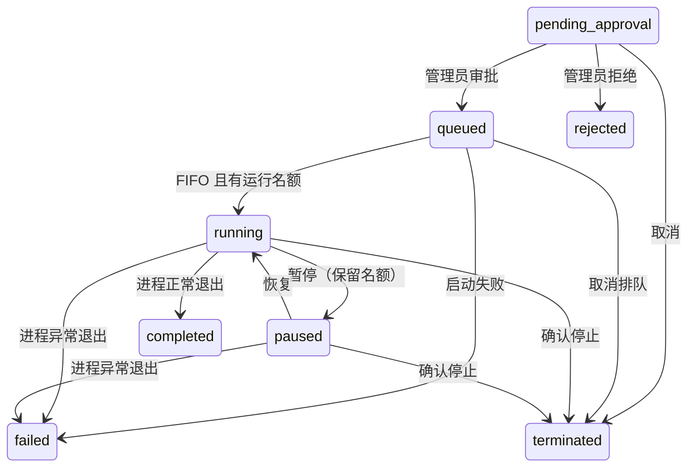

# 组织级并发限制与审批后排队

## 目标与范围

`maxConcurrent` 改为整个控制面实例的运行上限，所有用户（包括管理员）共享。
创建任务只进入待审批，不消耗运行名额；审批表示允许运行，有空位立即启动，
否则持久化为 `queued`，按照审批入队顺序 FIFO 启动。Python 和 Node 服务
实现相同契约，沿用现有 JSON 存储、Launcher 和凭据代理，不增加外部依赖。

本设计按单控制面进程部署。它限制被该实例管理的沙箱数量，不提供跨实例
分布式调度，也不替代操作系统的 CPU、内存或进程树资源限制。

## 配额和状态

| 状态 | 占运行名额 | 允许操作 |
| --- | --- | --- |
| pending_approval | 否 | 管理员审批/拒绝，所有者或管理员取消 |
| queued | 否 | 所有者或管理员取消；不可再次审批、暂停或恢复 |
| running | 是 | 所有者或管理员暂停/终止 |
| paused | 是 | 所有者或管理员恢复/终止 |
| completed / failed | 否 | 查看结果 |
| rejected / terminated | 否 | 查看结果 |

暂停保留名额，因为进程与内存仍存在；恢复不需要重新排队。
`maxConcurrent` 是 1–64 的整数，默认 8；`maxQueued` 是 1–10000 的整数，
默认 100，仅限制已审批、尚未启动的任务。待审批不计入两种配额。
非法值（包括布尔值、小数、字符串、零和越界值）返回 400，设置保持不变。
部分更新设置时保留未提交字段。

## API 与前端

- 创建仍返回 201 / `pending_approval`，不因运行配额已满而拒绝创建。
- `POST /api/sandboxes/:id/approve`：空闲时返回 200 / `running`；排队
  返回 202 / `queued`，包含 `queuedAt`、`queueOrder`、`queuePosition` 和
  审批者/时间。队列满返回 409，任务保持待审批，可稍后再次审批。
- 重复审批、非法状态转换返回 409。排队任务使用现有 `terminate` 取消，
  不创建进程、不签发出网 token；所有者与管理员之外的用户仍返回 404。
- 运行结束记录 `finishedAt`、`exitCode`，启动失败记录 `failureReason`。
  结束任务注销代理能力，防止已完成任务继续占据模型调用权限。
- 列表、筛选和总览增加排队、成功及失败状态。排队位置是组织内绝对位置，
  普通用户只能看到自己的任务，不获得其他排队用户或任务的详细信息。
- 前端定时刷新任务列表与指标，不覆盖正在编辑的表单或筛选条件；
  展示“排队第 N 位”，允许取消排队；终态不再展示终止按钮。

## 调度与互斥

每次审批、终止、修改配额后执行调度；后台每 0.5 秒检查退出并自动补位。
只有 `queued` 能被调度。任务分配持久化单调递增的 `queueOrder`，以它排序，
不依赖列表的展示顺序或相同精度的时间戳。

Python 使用已有全局锁串行化状态读改写和调度；Node 使用 Promise 互斥链
串行化相同的状态路由和后台调度，避免异步文件读写导致丢失任务或超配。
JSON 通过同目录临时文件加原子替换保存，读者不会看到半份 JSON。
API 返回前保存调度结果。后台失败记错误日志，下轮重试，不静默停掉调度。

先确认退出并释放能力，再按 FIFO 启动直到达到上限。一个启动失败的任务
进入 `failed`，不阻塞后面的任务；不自动无限重试。真正启动时重新检查最新
工作区白名单，并读取最新 Broker 凭据，排队阶段不注册出网能力。
Node 终止必须等待子进程退出才释放名额，超时升级 SIGKILL；不会在发送
SIGTERM 后立即补位。Python 同样沿用等待退出的停止语义。

降低配额不杀现有任务；当前占用高于新上限时停止补位，直至占用低于上限。
提高配额立即尝试补位。降低排队上限不丢弃已有队列，只拒绝新增入队。

## 重启与故障边界

队列状态与顺序随任务一起持久化，服务重启后继续调度剩余空位。
已有 `running` / `paused` 记录若不在新 Launcher 的进程表内，仍保留运行
名额并标记 `runtime.recoveryRequired`，不盲目信任磁盘 PID，也不把它当成
已退出然后超配。对此类任务，暂停、恢复、终止返回 409；运维需先通过
宿主服务管理确认旧进程已停止，再在停服维护窗口修正遗留状态。
自动重新附着跨重启进程、自动重试和跨实例锁不在本次范围内。

原子文件替换不能提供“进程启动”和“状态落盘”的跨系统事务。进程已启动
但状态保存前主机崩溃的窗口仍存在；生产环境应通过服务级进程清理/独立
执行器管理解决，不能将本队列声称为 exactly-once 执行系统。

## 验证与回滚

测试用例、执行命令和实际结果记录在
[CONCURRENCY-QUEUE-TESTS.md](CONCURRENCY-QUEUE-TESTS.md)。覆盖两种实现的
全局限额、管理员、FIFO、并行审批、取消、自然退出、启动失败、暂停保留
名额、动态配额、重启恢复、权限及非法设置。

回滚前暂停接收审批并清空或取消排队任务；旧版本不认识 `queued`、
`completed`、`failed`，不能直接将有这些状态的数据交给旧版继续调度。
保留数据备份，在停服窗口完成状态迁移。不要将排队状态改成待审批后
自动重新启动，以免重复执行。
